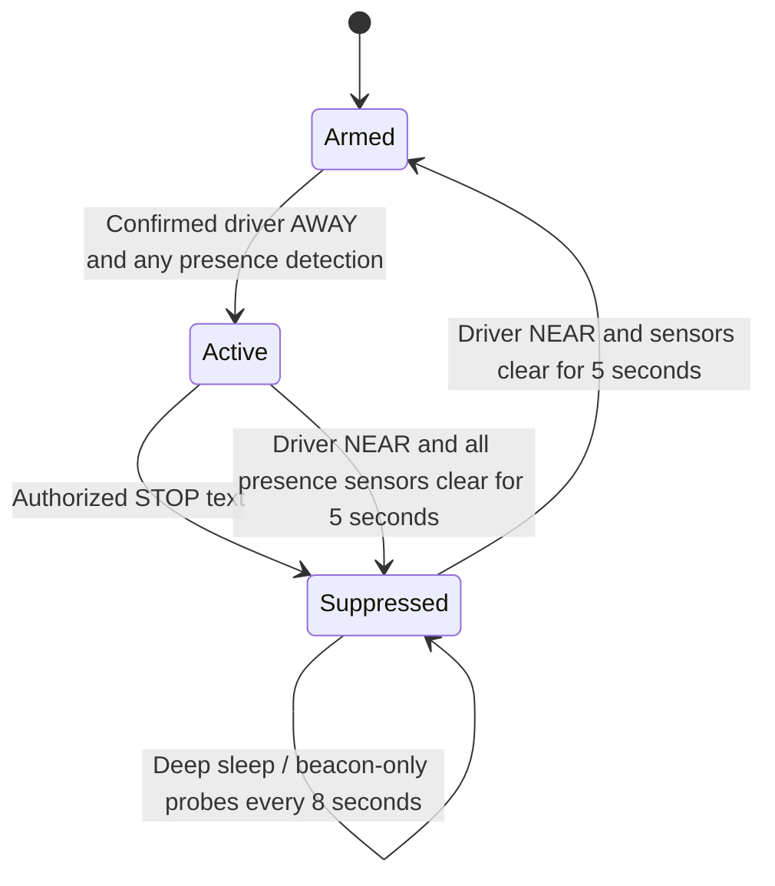

# Automatic presence alert workflow

The primary ESP32-S3 runs the timeline and temperature regression. The secondary
ESP32-WROOM-32 owns the TEL0161 modem and MCP2515. The Python viewer only displays
the device's measurements and forecast; USB and the viewer are not required for
alerts to operate.

## Incident lifecycle



Unknown/checking/failed BLE status does not start an incident. Presence is the
existing camera-face OR mmWave OR thermal heat-trace signal; sensor thresholds
and pin assignments are retained. An incident remains active when detections
briefly disappear while the driver is away.

The incident clock begins at qualified presence detection, not SMS submission.
At each milestone, actions are scheduled once:

| Elapsed time | Action |
| --- | --- |
| 0 | Text saved driver number; begin temperature sampling/history. |
| 3 minutes | Text driver and up to three saved emergency contacts. Evaluate the rolling forecast after this point on every new reading. |
| Forecast strictly above 104 F, from minute 3 onward | Request one recorded voice call to **+15129622126**, provided Emergency alerts is enabled in Wi-Fi setup. No redial, including failed/unanswered/unknown attempts. |
| 5 minutes | Start repeating horn and text driver plus emergency contacts again. Continue forecasting. |

Duplicate recipient numbers within a milestone are skipped. Missing/invalid
contacts are skipped; there is no fallback recipient. The first three driver
messages and the two emergency-contact rounds use these drafts (a recent valid
reading adds `Last temp: XX.X F.`):

- `Backseat Minder: Presence detected; driver away. Check vehicle now. Reply STOP to cancel.`
- `Backseat Minder: Presence alert active for 3 min. Check vehicle immediately. Reply STOP to cancel.`
- `Backseat Minder: Presence alert active for 5 min. Horn alarm requested. Reply STOP to cancel.`

Texts, calls, and network delivery cannot be guaranteed at an exact instant.
Actions queue locally at their deadlines; one modem transaction runs at a time.
A forecast call has priority over waiting texts, but cannot preempt a text already
being submitted. The five-minute horn control bypasses modem transactions.
A short incoming-SMS background transaction is allowed to finish before an
accepted outgoing command starts. Unknown SMS outcomes are never blindly retried.

## Temperature model (on ESP32)

`main/alert_workflow.h` keeps a fixed-size rolling history of valid DHT22 readings,
using their actual monotonic timestamps, with the existing 3-second sampling rate.
It fits least squares over the latest 180 seconds. The slope is stored in
`Workflow::slope_f_per_min`. The forecast is anchored at the current reading:

```
forecast_7min_f = current_temperature_f + 7 * slope_f_per_min
```

The controller requires at least three finite, in-range readings spanning at
least 30 seconds. Failed readings invalidate the current forecast; data older
than ten seconds cannot authorize a new forecast call. No values are interpolated
for failed measurements. Temperatures remain in Fahrenheit throughout.
The call threshold is strictly `forecast_7min_f > 104`, and cannot trigger before
three minutes have elapsed.

The BSMT USB sample includes alert state/elapsed time, forecast validity, slope,
and seven-minute prediction. The viewer plots measured temperature against device
time (relative to incident start when active) and draws the device-reported
forecast to +420 seconds, with a 104 F reference line. Its existing humidity trend
is retained; its temperature forecast no longer uses viewer-side regression.
The recent graph is visible when connected; the device does not store a full
incident archive or replay measurements missed while the viewer was disconnected.

## Cancellation, horn and sleep

STOP is matched case-insensitively after trimming surrounding whitespace; text
such as `STOP NOW` does not match. Sender digits must match a saved driver or
emergency-contact number (an optional leading `+` is ignored). Save contacts with
the country code used in incoming SMS sender IDs; no ambiguous suffix matching
is used. Unrecognized senders cannot cancel.

An accepted STOP cancels pending escalation texts/calls, stops the repeating horn,
and hangs up an active call. Incoming SMS is read/forwarded between voice AT
commands during dialing/playback. A text already being submitted may finish;
modem command boundaries and the network introduce cancellation latency. An audio
upload already in binary mode finishes its transfer before cancellation to avoid
leaving the modem consuming future AT commands as file data.

The horn uses the existing Q50 standard CAN ID **0x358**, DLC 8, 500 kbps and 8 MHz
MCP oscillator. ON is `42 02 00 00 00 00 00 00`; OFF is
`02 02 00 00 00 00 00 00`. It requests one second ON, two seconds OFF, repeating
until cancellation. ON refreshes are sent periodically; timing is best effort
while UART/CAN work is serviced. This sustained pattern needs vehicle validation;
only the earlier short chirp was previously hardware-confirmed. CAN errors disable
transmission and are not treated as proof that the vehicle horn changed state.
An unconfirmed OFF/hang-up prevents a normal stop acknowledgement/sleep.

Cancellation is latched in NVS. After acknowledged cancellation and completion
of any in-flight transaction, the primary sleeps and wakes for beacon-only probes
at the existing eight-second interval while the driver remains away. Sensors and
camera are not initialized during those suppressed probes. When the driver is
confirmed NEAR, sensors restart for a bounded ten-second check and must remain
clear for five seconds to rearm. If still occupied, it sleeps and checks again.
The same detection cannot restart the protocol immediately after STOP.
An active incident inhibits normal driver-present sleep. Wi-Fi setup requests
are deferred until the incident is inactive because setup blocks/reboots the
primary loop. Existing manual SMS test and short horn controls remain available.

The incident latch also prevents a reset from generating a second EMS call:
an interrupted incident restarts suppressed, not automatically resumed. Driver
return/clear rearms it. A persistence failure disables the emergency call for that
incident and records ALERT_STORAGE_ERROR. The modem/secondary must be power-cycled
together after an uncertain binary audio transfer. The primary's sleep does not
turn off the separately powered modem/secondary.

## Build and verification

- Primary: build the ESP-IDF project with its required ESP-WHO dependency and flash
  the S3. See [PRIMARY_BUILD.md](PRIMARY_BUILD.md) for the local environment and
  build helper. ESP_WHO_PATH selects the legacy framework checkout.
- Secondary: `pio run -d secondary_firmware -e esp32_wroom_32_alerts` enables both
  real SMS and recorded calls. Existing build environments retain their settings.
- In Wi-Fi setup save driver/emergency numbers and enable **Emergency alerts**
  to permit the +15129622126 call. The destination is currently the user-selected test phone number, hardcoded
  in the primary workflow. It is not an emergency-services destination.
- Host tests: `python tests/run_cellular_tests.py --zig` and
  `python tests/run_beacon_tests.py --zig` (optional ziglang compiler), plus
  `python -m unittest discover -s tools -p test_usb_telemetry_viewer.py`.

Host tests exercise timing, beacon gating, regression, the threshold, one-call
latching, saved-contact STOP authorization, sleep policy, primary UART actions,
voice cancellation and CAN scheduling. The main loop is also compiled against
SDK interface stubs. These checks do not replace a complete ESP-IDF build or
hardware testing of sensing, sustained CAN behavior, voice audibility, sender
formatting, deep sleep and network/SIM support. No hardware texts/calls/CAN frames
are sent by the tests.
